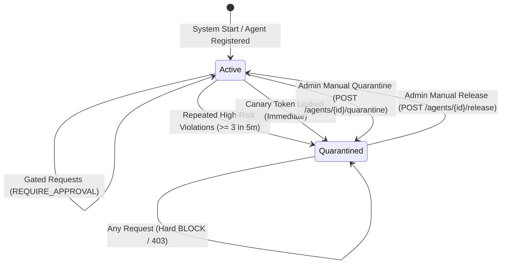

# System Architecture: Agent Hijack Shield (PS-023)

## 1. Executive Summary & Design Philosophy

**Agent Hijack Shield** is an adversarial security gateway and reverse proxy positioned between client applications, external data retrieval systems, and autonomous Large Language Model (LLM) agents.

Autonomous agents present a unique threat surface: because models execute natural-language instructions and possess tool-dispatching privileges, an attacker who injects instructions into the model's context window can trigger unauthorized real-world actions (data theft, fund transfers, unauthorized API calls, local file overwrites).

Agent Hijack Shield is built on the **Principle of Invariant Defense-in-Depth**:
1. **Never Trust the Model for Security Enforcement**: The model is considered an untrusted reasoning engine subject to cognitive hijacking. All security boundaries, permission controls, and rate limits are enforced deterministically outside the model.
2. **Fail-Closed by Default**: If any internal component encounters an error, timeout, unparseable payload, or ambiguity, the gateway rejects the request (`BLOCK` or `DENY`).
3. **Cryptographic Capability Separation**: Tools refuse execution unless presented with a single-use HMAC token bound to verified arguments. Capability tokens are generated internally or via human approval and are **never** returned to untrusted chat callers.
4. **Tamper-Evident Accountability**: Every event, scan result, tool decision, and approval is recorded in a forward-secure, SHA-256 hash-chained audit ledger.

---

## 2. Component Topology & Data Flow

```
                      +-----------------------------------------+
                      |      External Untrusted Content         |
                      |   (Web Scrapes, RAG Docs, Emails, APIs) |
                      +-----------------------------------------+
                                           |
                                           v
[ Client Application ] ===> [ AGENT HIJACK SHIELD GATEWAY ]
                                           |
      +------------------------------------+------------------------------------+
      | 1. Security Middleware (Rate Limit, 1MB Body Limit, Auth, ReqID)        |
      | 2. Multi-Stage Normalizer (Unicode NFKC, Base64/Hex/ROT13, Escapes)     |
      | 3. Inbound Pattern & Heuristic Detector (OWASP Top 10 Rule Engine)      |
      | 4. Provenance & Session Taint Tracker (Taint Escalation Engine)          |
      | 5. Policy Enforcement & Intent Verification Gate (YAML Least-Privilege)  |
      +------------------------------------+------------------------------------+
                                           |
                    +----------------------+----------------------+
                    |                                             |
         [ Auto-Authorized Tool ]                      [ High-Risk / Tainted Tool ]
                    |                                             |
                    v                                             v
       [ Capability Mint Engine ]                     [ Human Approval Queue ]
       - HMAC SHA-256 Token                           - SQLite Pending Ledger
       - Single-Use Bound                             - Admin/Approver Review
                    |                                             |
                    +----------------------+----------------------+
                                           |
                                           v
                             [ LLM Agent Execution Runtime ]
                                           |
                                           v
                        [ Outbound Checkpoint & DLP Filter ]
                        - Canary Token Extraction Inspection
                        - PII & Credential Masking
                        - Markdown Exfiltration URL Neutralization
                                           |
                                           v
                        [ Tamper-Evident Hash-Chained Audit ]
                        - Block_n = SHA256(Block_{n-1} || Data)
                                           |
                                           v
                               [ Safe Client Response ]
```

---

## 3. Core Subsystems

### 3.1. Security Middleware & Inbound Ingestion
- **Authentication & RBAC**: Enforces API key authentication using SHA-256 key hashing (`keys.py`). Keys carry discrete RBAC scopes: `admin`, `analyst`, `approver`, and `client`. In production (`APP_ENV=production`), all demo keys are rejected at startup.
- **Leaky Bucket Rate Limiter**: Enforces sliding-window request-per-minute quotas per API key/IP. Old entries are automatically evicted based on timestamp TTL to guarantee bounded memory consumption.
- **Strict Size Guardrails**: Terminates request bodies exceeding 1 MB with `413 Payload Too Large` to prevent memory bomb and buffer exhaustion attacks.

### 3.2. De-obfuscation Normalization Pipeline (`normalize.py`)
Attacker payloads frequently disguise injection signatures using encoding and homoglyph substitution. Before rule evaluation, input undergoes a deterministic multi-stage transformation:
1. **Recursion-Bounded De-encoding**: Iteratively detects and decodes Base64, Hexadecimal, and ROT13 encodings up to a maximum recursion depth of 3 and size limit of 64 KB.
2. **Unicode Homoglyph & Confusable Mapping**: Converts Cyrillic, Greek, mathematical bold, and full-width characters to Latin equivalents using NFKC normalization and curated lookup tables.
3. **Invisible & Control Character Stripping**: Removes zero-width spaces (`\u200b`), bidirectional control marks (`\u202a`–`\u202e`), soft hyphens, and null bytes.
4. **Delimiter & Boundary Neutralization**: Detects and neutralizes prompt injection delimiter tags (`<<<`, `>>>`, `[SYSTEM]`, `|im_start|`).

### 3.3. Inbound Heuristic & Regex Detector (`detector.py`, `rules.py`)
- Runs 45+ compiled regular expressions mapped directly to attack vectors (Direct Overrides, Role Reassignment, System Prompt Extraction, Fake Role Tags, Tool Poisoning, Concealment).
- **Educational Discount Heuristic**: Applies a calibrated risk discount when attack phrases appear inside educational inquiries (e.g., `"Explain how 'ignore all previous instructions' works"`), provided the request is from a direct user and contains no untrusted external documents.
- **Fail-Closed Execution**: If any regex evaluation exceeds its allocated timeout, the detector fails closed and returns `BLOCK`.

### 3.4. Provenance & Session Taint Tracking (`trust.py`, `session.py`)
- **Zero-Trust External Content**: External documents (web scrapes, PDFs, RAG chunks, emails) are forcefully coerced to `trust_level=EXTERNAL`.
- **Cryptographic Enclosure**: External texts are safely wrapped within unpredictable 128-bit boundary tokens (`<<<EXTERNAL_UNTRUSTED_CONTENT_<hex>_source:...>>>`).
- **Taint Propagation**: Any turn that processes external content permanently sets `is_tainted=True` on the session context. In tainted sessions, all side-effect tools automatically escalate to `REQUIRE_APPROVAL` and financial tools are hard `DENY`ed.

### 3.5. Policy Gate & Cryptographic Capability Mint (`policy_gate.py`, `permissions.py`)
- Evaluates tool calls against declarative YAML policies (`policies/<agent_id>.yaml`).
- **Tool Classifications**:
  - `allowed_tools`: Safe read-only tools permitted for autonomous execution when session is untainted.
  - `require_approval_tools`: Sensitive side-effect tools requiring human authorization.
  - `denied_tools`: Explicitly forbidden tools (`execute_bash`, `delete_file`, `drop_tables`).
- **Domain-Separated Capability Tokens**:
  - Issued only when a tool call is fully authorized or human-approved.
  - Token Structure: `ahs_cap_<header_b64>.<payload_b64>.<hmac_signature_hex>`.
  - Cryptographically bound to `(agent_id, tool_name, args_hash, request_id)` with a 5-minute expiry.
  - Tracked in an in-memory single-use replay cache; second execution attempt fails immediately.
  - **Invariant**: Capability tokens are **never** returned in `/v1/chat` responses to untrusted clients.

### 3.6. SSE Events Token Minting (`events.py`)
- Real-time audit and dashboard log streaming is mediated via Server-Sent Events (`/v1/events/stream`).
- SSE tokens are minted via `POST /v1/events/token` using a **domain-separated subkey**:
  $$\text{Subkey}_{\text{SSE}} = \text{HMAC-SHA256}(\text{MasterKey}, \text{"AgentShield:DomainSeparation:SSE-Token:v1"})$$
- SSE tokens use the distinct prefix `sse_tok_` and a 60-second TTL, preventing any capability token substitution or cross-protocol confusion.

### 3.7. Outbound DLP & Canary Token Guard (`outbound.py`)
- **Canary Injection**: A unique cryptographic canary (`ahs_canary_<uuid>`) is injected into the model's system prompt instructions.
- **Leak Detection**: Outbound model text is scanned for the canary token. Detection indicates successful system prompt exfiltration, triggering immediate response redaction and **automatic quarantine** of the agent and session.
- **Markdown Image Stripping**: Strips auto-exfiltrating image tags (``) to prevent silent data transfer via browser rendering.

### 3.8. Tamper-Evident Hash-Chained Audit Ledger (`audit.py`)
- Every gateway interaction is recorded in a cryptographic audit chain in SQLite:
  $$\text{Hash}_n = \text{HMAC-SHA256}_{K_{\text{audit}}}(\text{Hash}_{n-1} \,\|\, \text{Timestamp} \,\|\, \text{RequestID} \,\|\, \text{AgentID} \,\|\, \text{Action} \,\|\, \text{Verdict} \,\|\, \text{Details})$$
- The chain is verifiable via `GET /v1/audit/verify`. Any out-of-band record insertion, update, or deletion breaks the hash linkage and identifies the exact compromised record index.

---

## 4. Circuit Breaker Quarantine State Machine



1. **Active State**: Normal processing. Requests are mediated through inbound and policy checks.
2. **Automated Quarantine Trigger**: Triggered when a session or agent accumulates violations exceeding threshold (3 blocked requests within 5 minutes) or leaks a canary token.
3. **Quarantined State**: All inbound requests for the agent or session are rejected at the edge with reason `AGENT_QUARANTINED` or `SESSION_QUARANTINED`.
4. **Administrative Release**: Non-admin roles receive `403 Forbidden` if attempting release. Only an authenticated user with the `admin` role can release a target from quarantine.

---

## 5. Security Invariants Verification Summary

| Invariant | Implementation Mechanism | Verification Test |
| :--- | :--- | :--- |
| **No Demo Keys in Production** | `AppConfig` validation on startup (`check_production_safety`) | `tests/unit/test_security_core.py::test_production_refuses_demo_keys_and_seed_refuses_non_dev` |
| **Fail-Closed Lifespan Boot** | Lifespan context checks DB keys before opening listener | `tests/unit/test_security_core.py::test_app_lifespan_refuses_boot_with_production_and_demo_keys` |
| **Single-Use Capability Tokens** | In-memory consumed token hash set with 5m TTL | `tests/unit/test_phase4_permissions.py::test_capability_tokens_single_use_and_replay_rejection` |
| **No Capability Tokens in Chat** | Pydantic `Field(exclude=True)` on `ToolCallDecision` | `tests/integration/test_pipeline_scenarios.py::test_pipeline_benign_calculation` |
| **Domain-Separated SSE Tokens** | Subkey derivation with prefix `sse_tok_` | `tests/unit/test_security_core.py::test_sse_events_token_and_auth` |
| **Tamper-Evident Audit Chain** | Keyed HMAC-SHA256 recursive hash chain | `tests/security/test_security_attacks.py::test_audit_log_deletion_and_insertion_detection` |
| **Admin-Only Quarantine Release** | FastAPI dependency `require_role("admin")` | `tests/unit/test_phase4_permissions.py::test_admin_only_quarantine_release` |
